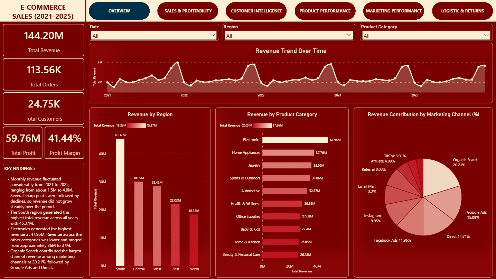
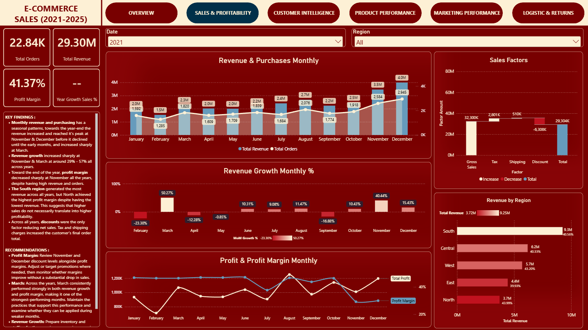
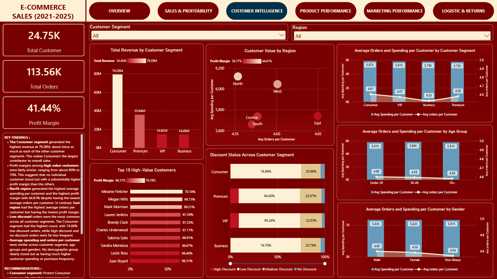
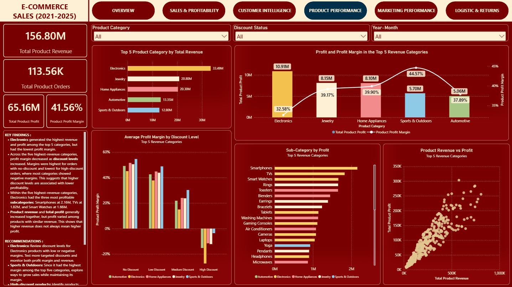
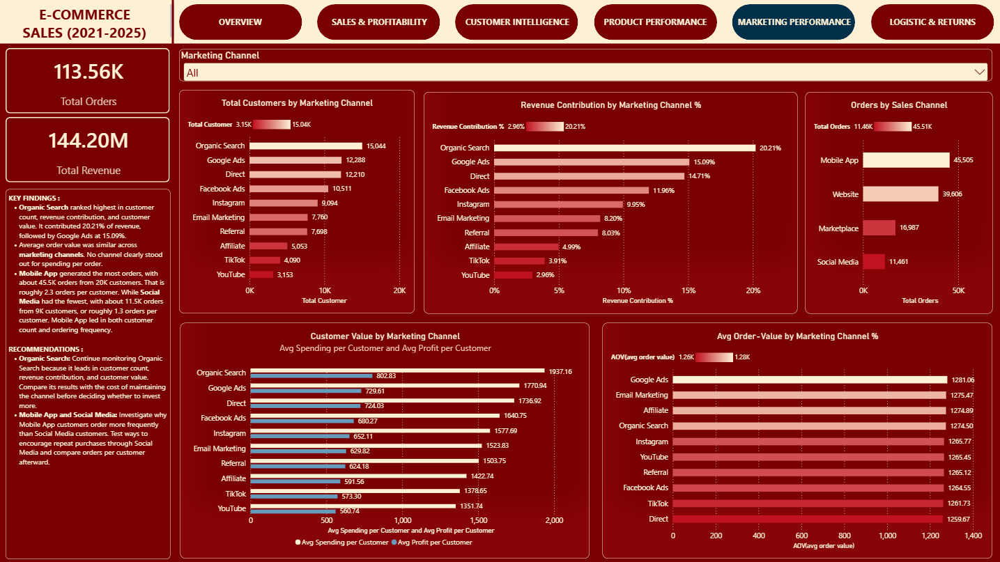
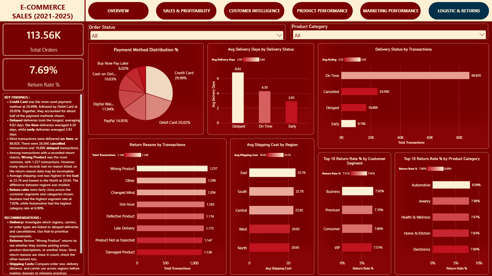

# Ecommerce Sales Analysis

## Overview

This project analyzes ecommerce sales data from **2021 to 2025** to understand revenue, profitability, customer behavior, product performance, marketing channels, and operations.

The analysis uses **MySQL** for querying and cleaning and **Power BI** for interactive visualization and business insights. The SQL file includes exploratory analyses, while the dashboard presents selected questions and findings.

---

## Business Questions

* How has revenue changed over time, and which periods show notable growth or decline?
* Which regions and product categories generate the most revenue and profit?
* How are discount levels associated with sales and profit margins?
* Which customer segments and regions have the highest customer value?
* Do purchasing patterns differ across customer segments, age groups, and genders?
* Which products and subcategories contribute the most revenue and profit?
* Which marketing channels contribute the most customers and revenue?
* How do payment methods, delivery performance, shipping costs, and returns vary?

---

## Tools

* MySQL
* Power BI
* DAX

---

## Analysis

### 1. Sales and Profitability

Analyzed monthly revenue trends, year-over-year growth, regional and category performance, discount levels, profit margins, and sales factors.

### 2. Customer Intelligence

Analyzed customer segments, customer value, loyalty, regional behavior, demographics, and purchase frequency.

### 3. Product Performance

Compared product and category revenue, profit, profit margin, demand, and discount patterns.

### 4. Marketing Performance

Compared acquisition channels by customer count, revenue contribution, customer value, and purchasing behavior.

### 5. Operations and Returns

Analyzed payment methods, delivery status and time, shipping costs by region, return rates, and recorded return reasons.

---

## Key Findings

* Monthly revenue fluctuated from roughly **1.5M to 4.0M**, with recurring peaks and declines rather than steady growth.
* The **Consumer** segment generated **79.28M** in revenue, substantially more than any other customer segment.
* The **North** region had the highest average spending per customer and profit margin (**44.61%**), despite having the lowest average orders per customer. The **East** had the highest average orders per customer but the lowest regional profit margin.
* **Electronics** generated the most revenue and total profit among the five highest-revenue categories, but had the lowest profit margin among them.
* Across the five highest-revenue categories, higher discount levels were associated with lower profit margins. This is an observed association, not proof that discounts alone caused the decline.
* The top-five products by revenue and by profit were mostly different. **Xiaomi** led in revenue at **807.67K**, while **Messika** led in profit at **303.34K**. Only **OnePlus Adaptive** appeared in both lists.
* **Organic Search** contributed **20.21%** of revenue, followed by **Google Ads** at **15.09%**. The **Mobile App** generated the most orders, at about **45.5K**; Social Media generated about **11.5K**.
* Most transactions were delivered on time. Among returns with a recorded reason, **Wrong Product** was the most common; blank reasons are treated as missing information.

---

## Recommendations

* Review products with medium or high discounts and low or negative margins. Test targeted discount changes and monitor both sales and profit margin.
* Investigate which products, categories, or channels contributed to recurring revenue peaks before trying to reproduce those results in lower-growth months.
* Examine the sources of delayed deliveries, cancellations, and wrong-product returns before changing operational processes.
* Continue monitoring Organic Search performance alongside the cost of maintaining the channel.

These are proposed next steps based on the analysis. They would need to be tested and validated in a business setting.

---

## Project Files

* **SQL analysis:** queries for data exploration and business questions.
* **Power BI report:** interactive dashboard with selected analyses.
* **Dashboard images:** visual previews of the report.

## Suggested Repository Structure

## Repository Structure

```text
E-Commerce Sales/
├── 1.Data/
│   ├── Clean Data/
│   │   ├── customer_master_clean.csv
│   │   ├── dataset_statistics_clean.csv
│   │   ├── ecommerce_sales_analytics_clean.csv
│   │   ├── order_items_clean.csv
│   │   └── product_catalog_clean.csv
│   └── Raw Data/
│       ├── customer_master.csv
│       ├── dataset_statistics.csv
│       ├── ecommerce_sales_customer_analytics_150k.csv
│       ├── order_items.csv
│       └── product_catalog.csv
├── 2.Notebook/
│   ├── analysis.sql
│   ├── customer_master_clean.sql
│   ├── dataset_statistics_clean.sql
│   ├── ecommerce_sales_analytics_clean.sql
│   ├── order_items_clean.sql
│   └── product_catalog_clean.sql
├── 3.Dashboard/
│   └── E-Commerce Sales Dashboard.pbix
├── 4.Images/
│   ├── 01_Overview.png 
│   ├── 02_Sales_&_Profitability.png 
│   ├── 03_Customer_Intelligence.png 
│   ├── 04_Product_Performance.png 
│   ├── 05_Marketing_Performance.png 
│   └── 06_Logistic_&_Returns.png 
└── README.md
```
---

## Dashboard

The Power BI dashboard presents selected analyses across sales, customer intelligence, product performance, marketing, and operations. Not every exploratory SQL question is represented as a separate chart.

### Overview



### Sales & Profitability



### Customer Intelligence



### Product Performance



### Marketing Performance



### Logistic & Returns




## Dataset and Metric Notes

The project uses cleaned ecommerce tables, including `ecommerce_sales_analytics_clean` and `order_items_clean`. The first contains order-level records; the second contains product-line records, so one order can appear on multiple item rows.

* Order counts use distinct `order_id` values. Product and category analyses use item-level records.
* Overall revenue is taken from the order-level table; product and category revenue are calculated from the item-level table.
* **Data limitation:** summed monetary values in the order-level and item-level tables do not reconcile, even though their distinct order counts match. Results from the two tables should not be combined as if reconciled. This discrepancy should be resolved before using the figures for financial reporting.
* Although the dataset includes a profit margin percentage column, profit margin is calculated from aggregated profit and revenue: `SUM(profit) / SUM(net_sales)`, so the result reflects the combined performance of each group.
* Discount bands are based on item discount percentages: **No Discount** = 0; **Low** = greater than 0 and up to 25%; **Medium** = greater than 25% and up to 50%; **High** = greater than 50%.
* Return-reason comparisons exclude blank reasons and refer only to returns with a recorded reason.

Dataset: E-Commerce Sales
Source: Kaggle

---

## Author

Rezki Surahmi

Aspiring Data Analyst passionate about turning data into meaningful insights through analysis and visualization.

GitHub: https://github.com/rezkisr